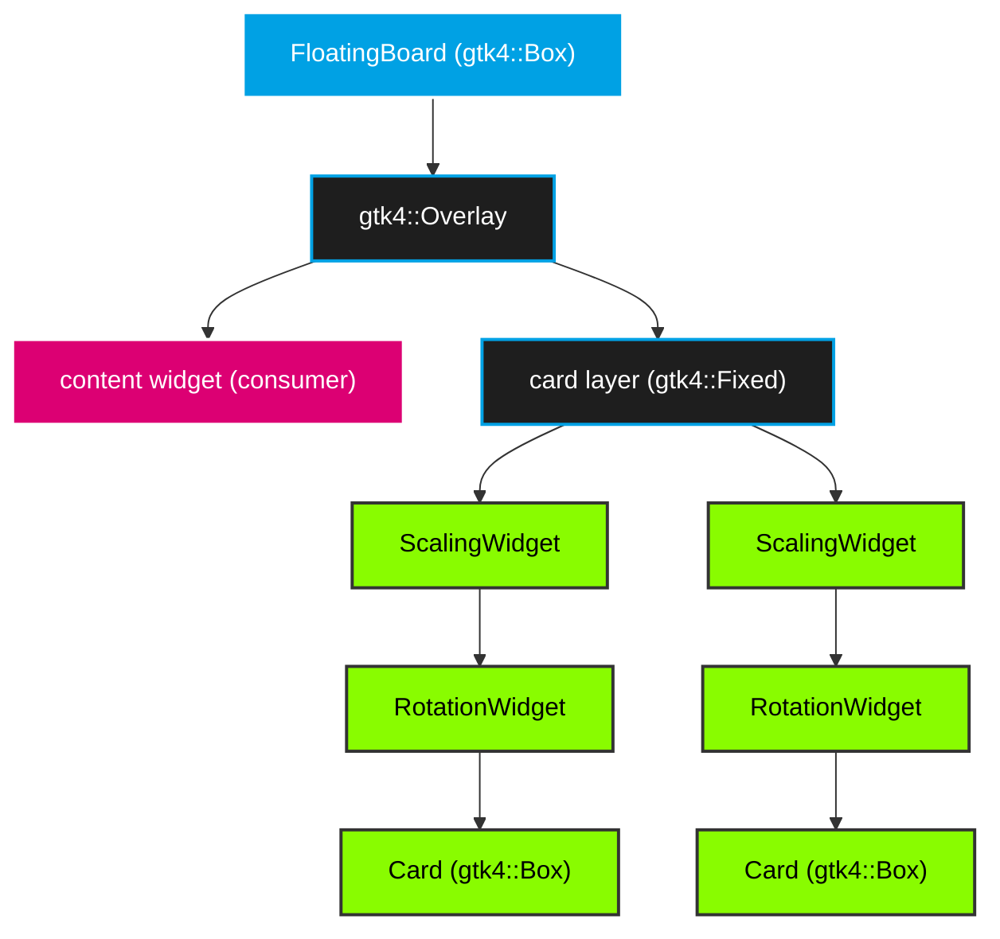
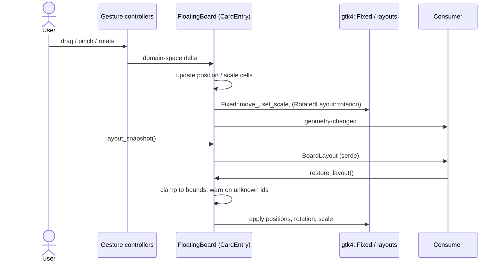

# Architecture

`floating-board` is split into two layers: a pure domain core and a thin GTK
widget layer that maps GTK mechanics (gestures, layout, transforms) onto
domain operations.

```text
┌─────────────────────────────────────────────────────────────────┐
│ Consumer application                                            │
│   floating_board::FloatingBoard + domain types in/out            │
├─────────────────────────────────────────────────────────────────┤
│ src/widget/   - ObjectSubclass glue (gestures, layout, CSS)      │
│   FloatingBoard > Overlay { content, Fixed { card stacks } }     │
├─────────────────────────────────────────────────────────────────┤
│ src/domain/   - pure Rust, no gtk4                               │
│   NewTypes, Enums, geometry math, BoardLayout serde              │
└─────────────────────────────────────────────────────────────────┘
```

## Widget Stack



- **`FloatingBoard`** is a `gtk4::Box` composite. Its internal `GtkOverlay`
  holds the consumer's content widget as the bottom layer and a transparent
  `gtk4::Fixed` as the card layer on top. Consumers only ever see
  `add_card`/`remove_card`/`card`/`set_content` — never the overlay itself.
- **Card layer (`gtk4::Fixed`)** positions each transform stack by top-left
  coordinates. It has no background of its own: its pick test only hits card
  children, so gestures on empty areas fall through to the content below.
- **Transform stack** per card: `ScalingWidget { RotationWidget { Card } }` —
  outer scale, inner rotation. Both transforms are applied via
  `gsk::Transform` at allocation time, which means GTK4's picking machinery
  automatically applies the full inverse stack `scale⁻¹ · rotate⁻¹` when
  delivering events — controls on rotated, scaled cards stay usable.

## The Card

```text
┌─ Card (gtk4::Box, .floating-card) ─────────────────────────────────┐
│ ┌─ Header (.floating-card-header, drag affordance) ──────────────┐ │
│ │ [≡ handle] Title  ········· [fold] [close]                     │ │
│ └────────────────────────────────────────────────────────────────┘ │
│ ┌─ Content (.floating-card-content) ─────────────────────────────┐ │
│ │ arbitrary consumer widget                                      │ │
│ └────────────────────────────────────────────────────────────────┘ │
└─────────────────────────────────────────────────────────────────────┘
```

- `Card` is a `gtk4::Box` subclass: header strip plus a content holder for the
  consumer widget. Chrome (handle icon, title, fold button, close button) is
  controlled by `CardConfig` flags (`foldable`, `closable`, `headerless`,
  `drag_handle`).
- The card is a **view**: it owns no geometry. `card.geometry()`,
  `set_position`, `set_rotation`, `set_scale`, `raise` all delegate to the
  `FloatingBoard` through a weak backlink set up at `add_card`.

## Coordinate Spaces

`CardPosition` is the card's **center** in board pixels. `gtk4::Fixed`
positions children by top-left, so the board converts on every move:

$$\text{top-left} = \text{center} - \frac{\text{displayed size}}{2}$$

The *displayed size* is predicted, not read back: `RotatedLayout`'s measure
reports the rotated bounding box of the card's natural size, and
`ScalingLayout` multiplies it by the scale factor — so
`rotated_bounds(natural_w · s, natural_h · s, θ)` always equals the size
`GtkFixed` will allocate next. This keeps the center anchor exact even while
rotation or scale transitions are still pending re-allocation.

## Gestures

| Gesture | Controller | Effect | Conflict rule |
|---------|-----------|--------|---------------|
| 1-finger drag on header/handle/card | `GestureDrag` | move card (live), clamp on end, `card-moved` | exclusive per sequence |
| 1-finger touch on card | `GestureClick` | raise card on release, `card-raised` | claims only on release without movement — also raises after a finished drag |
| 2+ finger transform | quad tracker (`EventControllerLegacy`) | similarity transform: centroid = move, radius = scale, point-cloud angle = rotate | one mechanism, nothing to arbitrate |
| 1-finger touch on empty area | — | falls through to content | pick-based, no controller needed |

### The quad transform gesture

Move, rotate and zoom are **one** gesture, not three competing ones. A raw
`EventControllerLegacy` on the card observes every touch sequence
(`TouchBegin`/`Update`/`End`/`Cancel`) without claiming any — each finger
maps to a tracked board-space point and interactive content keeps working.
(`GestureSingle`-based slots were abandoned: a single locks onto the first
sequence it sees and cannot distribute touches across siblings.)

With `QUAD_MIN_POINTS` (2) or more live points the board fits a transform
between the baseline point cloud and the current points:

- **Move**: the card center follows the point-cloud centroid (the card point
  under the finger polygon stays fixed).
- **Scale**: the RMS radius ratio of the two point sets, clamped to
  `scale_limits` — the card keeps its aspect ratio.
- **Rotate**: the Procrustes angle `atan2(Σ w×u, Σ w·u)` between the two
  point sets, applied via `RotationWidget::set_rotation` (negated — the
  angle is computed in y-down screen coordinates).

The baseline re-snapshots whenever a finger joins or leaves, so the
transform never jumps; a frame-to-frame angle jump beyond `60°` is treated
as a degenerate finger crossing (points through the centroid) and re-baselines
instead of applying. Tracked touches that get claimed by another gesture or
produce no event for `1.5 s` are swept out, so lost `TouchEnd` events cannot
linger as phantom points. smearor-wrot-rotation's built-in rotate gesture is
disabled; `rotatable`/`scalable`/`draggable` gate which transform degrees of
freedom apply.
| 1-finger touch on empty area | — | falls through to content | pick-based, no controller needed |

### Drag deltas in board space

`GestureDrag` reports offsets in the coordinate space of the drag source —
which lives *inside* the rotated/scaled transform stack and *moves* with the
card. Mapping that delta under the current transform creates a feedback loop
(the reference frame shifts as the card tracks the pointer), visible as
jitter and reduced pointer speed. The board therefore derives the drag delta
from two **board-space pointer samples**: the pointer position is read from
`Gesture::current_event`'s surface coordinates and mapped through
`Native::compute_point` into the card layer — independent of the card's own
transform. A pure-vector fallback (`rotate_vector · scale`) covers the window
before the first allocation.

### Surface input region

`smearor-wrot-rotation` is built for layer-shell surfaces and narrows the
surface input region to each card's footprint on every allocation. Inside a
regular window that would make everything outside the last-allocated card
input-dead, so the board restores the full input region (`None`) at the end
of its `size_allocate` — every card allocation runs inside that call, so the
reset always wins.

### Rotation tracking

`RotatedLayout` exposes `rotation` as a notify-able GObject property. The
board connects `notify::rotation` once per card: any rotation change —
gesture snap or programmatic — re-centers the card on its anchor, re-clamps
it into the bounds, and emits `card-rotated` plus `geometry-changed`.

## Boundary Clamping

After a drag ends and whenever rotation, scale or the board size changes,
each card is pushed back so that at least `CardConfig::min_visible` pixels of
its footprint overlap the board bounds on each axis. The math is the pure
function `domain::clamp_offset(footprint, bounds, min_visible) -> (dx, dy)`
— see [Domain Model](domain_model.md#clamp_offsetfootprint-bounds-min_visible---f64-f64).

## z-Order

The child order of the `gtk4::Fixed` layer is the stacking order. A released
click (or finished drag) removes and re-appends the card's transform stack,
raising it to the top. At `add_card`, an optional `CardConfig::z_index` sorts
the layer stably by insertion sequence.

## Anchor Resolution

`CardConfig::position` is a `CardAnchor` stored as *pending* until the board
is first allocated (the card's natural size and the board bounds must be
known). `domain::resolve_anchor` then computes the center — edge anchors hold
the card `ANCHOR_MARGIN` inside the bounds — and the card is moved into
place. `CardAnchor::Explicit` resolves eagerly at `add_card`.

## Multi-User

GTK touch sequences are independent per `EventController`, hence per card:
different users can drive different cards simultaneously. Simultaneous
rotate+pinch on the same card is allowed; one card serves one active drag
sequence at a time.

## State Flow



All mutations flow through the board; signals (`card-moved`, `card-rotated`,
`card-scaled`, `card-raised`, `card-folded` on the card; `card-added`,
`card-removed`, `geometry-changed` on the board) are emitted after state
updates so consumers can debounce persistence on a single channel.
