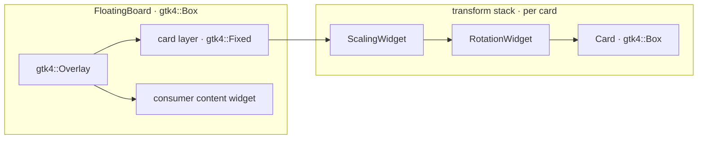

# Cards

A **card** is the unit of content on the board: an arbitrary consumer
widget wrapped in movable, rotatable, scalable chrome. Cards are views —
they own no geometry. The `FloatingBoard` is the single state owner, and
every `Card` delegates reads and writes to it through a weak backlink
established at `add_card`.

## What's inside

- **[Anatomy](cards/anatomy.md)**: what a card is made of — header
  strip, drag handle, title, fold and close buttons, content area,
  resize and rotate grips, and the folded states.
- **[Chrome](cards/chrome.md)**: configuring the frame —
  `DragHandle` variants, `headerless`, fold modes including
  `folded_content`, `CardCloseAction`, per-card `CardPalette`,
  `content_padding`, size caps and `z_index`.

## The card API at a glance

| Group | Methods |
|---|---|
| Identity | `id()`, `title()`, `board()` |
| Geometry | `geometry()`, `set_geometry()`, `position()`, `set_position()`, `rotation()`, `set_rotation()`, `scale()`, `set_scale()` |
| Animation | `set_rotation_with_animation()`, `glide_to()` |
| Chrome | `fold()`, `set_folded()`, `folded()`, `close()`, `raise()`, `reset()` |
| Tabletop | `seat()`, `set_seat()`, `sticky()`, `set_sticky()` |
| Diagnostics | `rendered_bounds()`, `placed_position()`, `ancestor_chain()`, `footprint()`, `content()` |

Signals: `card-moved`, `card-rotated`, `card-scaled`, `card-raised`,
`card-folded`, `card-seat-changed`. See [Usage](usage.md#signals) for
the full table and [Gestures](gestures.md) for how user input turns
into geometry.
