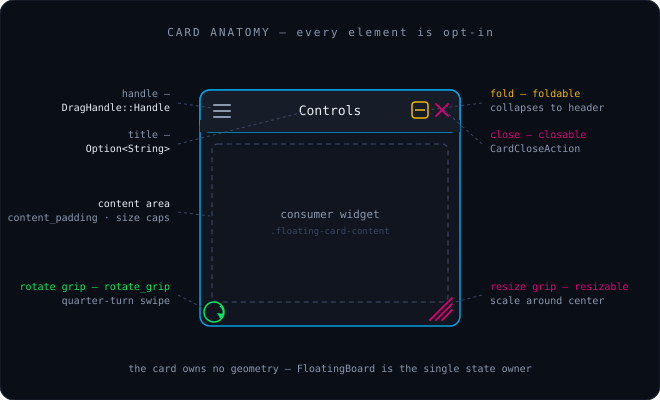

# Anatomy

A card is a `gtk4::Box` subclass with two vertical sections: the
**header strip** (the chrome: handle, title, fold and close buttons)
and the **content area** (an arbitrary consumer widget). Optional
grips sit on the bottom corners. Everything outside the flags a
`CardConfig` enables is never built.

This page describes the default `Rectangle` silhouette. `CardConfig::shape`
swaps it for `Circle`, `Semicircle`, `Hexagon`, `Octagon` or `Annulus` —
chrome then rides on arc or bar bands instead of a header, the content
area is governed by `CardContent`, and the card is clipped and
hit-tested along the shape. See [Shapes](shapes.md).

<figure class="diagram">
  
  <figcaption>the anatomy of a fully chromed card — every element is opt-in</figcaption>
</figure>

## The header strip

`.floating-card-header` carries the drag affordance and the window
controls:

| Element | Flag | Notes |
|---|---|---|
| handle icon | `drag_handle: Handle` | three-line grip; only shown for `DragHandle::Handle` |
| title | `title: Option<String>` | a localized fallback is used when the header shows without a title |
| fold button | `foldable` | collapses the card to its header |
| close button | `closable` | runs the card's `CardCloseAction` |

`headerless` collapses the whole strip to a slim grip — for cards that
still need a fold/close path but no title bar.

Non-rectangular shapes have no header strip at all: `Circle` and
`Annulus` mount inline chrome on arc bands, `Semicircle` on a top arc
plus a bottom bar, `Hexagon`/`Octagon` on straight top/bottom edge bars
(see [Shapes](shapes.md#chrome-on-shaped-cards)).

## The content area

`.floating-card-content` holds one consumer widget — the card imposes
no structure on it. `content_padding` (default 10 px) insets it from
the card border. `max_width`/`max_height` cap the *measured* size, so
a card stays stable when its content changes size — the cap applies
to the natural size before rotation and scale.

Interactive content keeps working: the transform stack inverts
rotation and scale during picking, and the quad tracker never claims
touch sequences (see [Quad Transform](../gestures/quad.md)). Buttons,
entries and canvases on a card behave exactly as if they were not
floating.

On non-rectangular shapes the content area is additionally clipped by
the card silhouette and — in the immersive `CardContent` modes
(`Fill`, `Clipped`, `Cover`) — made display-only so picks in the cut
corners or an `Annulus`' hole fall through to the cards below. The
details live in [Shapes](shapes.md#cardcontent--how-content-fills-a-shape).

## The grips

| Grip | Flag | Gesture |
|---|---|---|
| resize grip | `resizable` | bottom-right corner; drags scale the card around its center within `scale_limits` |
| rotate grip | `rotate_grip` | bottom-left corner; a swipe quarter-turns the card in the swipe direction |

Both are one-finger gestures — useful complements to the two-finger
transform, and the only rotate path for single-handed use.

## The folded states

Folding is a state, not a chrome detail — it is stored in
`CardGeometry`-adjacent state, serialized in `BoardLayout` and reported
via `card-folded`:

- **Plain fold** (`foldable` + `set_folded(true)`): the content area
  collapses; the card shrinks to its header strip. `.floating-card-folded`
  is added to the style classes.
- **`folded_content`**: a consumer widget that replaces the *whole*
  card while folded — header included. Chrome is stripped
  (`.floating-card-collapsed` makes the card background transparent)
  and the folded widget shows inside `.floating-card-folded-content`.
  A round icon button or a compact mini toolbar both work; wire its
  activation back to `set_folded(false)` — the card's own fold button
  hides with the header.

## z-order

`Card::raise()` re-appends the card's transform stack on the
`gtk4::Fixed` layer — the child order *is* the stacking order. A
released click (or finished drag) raises automatically; `z_index`
sorts the initial order stably by insertion sequence.
