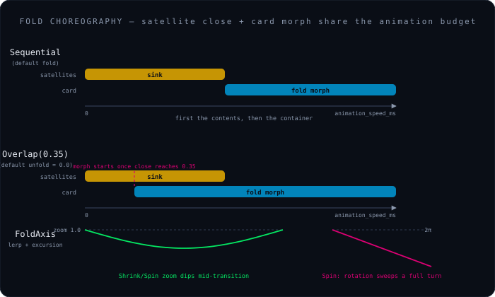

# Animations

Almost everything a card does can animate — rotation steps, glides,
folding, satellites opening and closing, plus one-shot effects. One
budget rules them all: `animation_speed_ms` (default 500 ms) is the
per-card duration for rotation, glide and camera moves *and* for the
fold choreography and satellite transitions below. When
`gtk-enable-animations` is off (reduced motion), every transition lands
atomically — same states, no tween.

## Folding and unfolding

`fold_animation` picks the morph between the unfolded card and its
folded presentation:

| `CardFoldAnimation` | Effect |
|---|---|
| `Instant` (default) | atomic swap — no transition |
| `Crossfade` | outgoing content fades out, folded content fades in, footprint tweens linearly |
| `Shrink` | footprint tween plus a mid-transition zoom dip (−0.45) and crossfade — a big card morphing into its miniature |
| `Spin` | like `Shrink` plus a full revolution swept through the dip — starts and ends at the card's own rotation |

`unfold_animation` is optional: unset, the unfold replays
`fold_animation`'s variant. Asymmetric pairs are idiomatic — the clock
in `examples/satellites.rs` folds with `Spin` and unfolds with a quiet
`Shrink`.

`unfold_on_click` makes a folded card's `folded_content` its own unfold
button — the gesture claims only taps, drags still move the card.

## Timing against the satellite set

`fold_timing` / `unfold_timing` (`CardFoldTiming`) decide when the morph
plays relative to the satellites closing and reopening:

<figure class="diagram">
  
  <figcaption>`Sequential` reads as cause and effect; `Overlap(fraction)` blends the morph into the set's close — plus the `FoldAxis` excursion curves</figcaption>
</figure>

- **`Sequential`** (default for folding): satellites sink into the card
  first; the morph starts when the last close transition lands — first
  the contents, then the container.
- **`Overlap(Fraction)`**: the morph starts once the leading
  satellite's close progress reaches the fraction — `0.0` runs fully
  parallel, `1.0` converges on `Sequential`. Unset `unfold_timing`
  defaults to `Overlap(0.0)`: on the way back the card morphs while the
  set is still re-emerging.

Under the hood each animated pose is a `FoldPose` — footprint, zoom,
rotation and both opacities — produced by `FoldAxis`, a lerp plus a
sinusoidal excursion that peaks mid-transition (the zoom dip, the full
turn). Being pure domain math, the curves are unit-testable and
independent of the widget layer.

## Satellite transitions

Opening and closing a satellite set is itself animated: satellites
emerge from (and collapse back into) a seed position on the card with
staggered `start_at` offsets, so the set fans out rather than popping
in. Retargeted placements tween too — a card resize or layout change
moves the orbit smoothly instead of snapping. While a satellite is in
flight its resolved placement keeps tracking card gestures, so a card
dragged mid-transition carries its opening set along.

Two interactions to know:

- `CardSatellites::open` and `board.set_satellites_open(&id, …)`
  trigger these transitions — see [Satellites](satellites.md).
- The fold choreography above is timed against exactly these close
  transitions; the `Minimize` satellite exempt from hiding on a folded
  curved card also stays through the choreography.

## One-shot effects

`board.play_card_fx(id, spec, options)` and
`board.play_satellite_fx(id, satellite, spec, options)` render a
`smearor-commons-fx` `EffectSpec` over a card or satellite: the
widget's transform stack is snapshotted to a texture, an `FxPlayer`
plays the effect over it, and the live widget swaps back on
`animation-ended`. `FxPlayOptions::duration == ZERO` defaults to the
card's `animation_speed_ms` budget. The snapshot is static — geometry
changes during playback don't track until the widget returns.

## What animates elsewhere

| Surface | Where |
|---|---|
| `set_rotation_with_animation`, `glide_to` | [Gestures](../gestures/drag.md) — the same `animation_speed_ms` budget |
| `goto_card` camera moves (`Snap`/`Glide`/`Transit`) | [Workspace & View](../workspace/goto.md) |
| Pass-to-seat flight | [Tabletop](../tabletop/passing.md) |
| Quad gesture inertia | [Quad Transform](../gestures/quad.md) |
