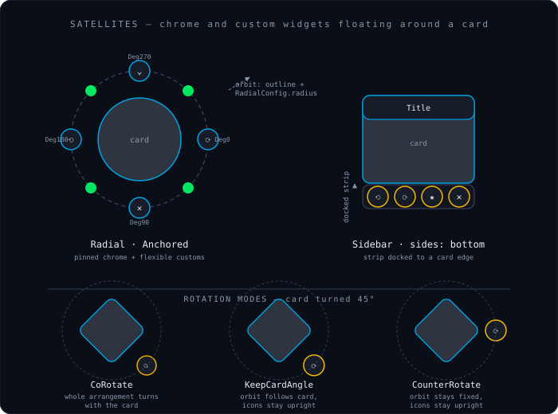

# Satellites

A **satellite** is a small widget the board places *outside* a card's
silhouette — orbiting it or docked to an edge. Satellites carry chrome
elements (`Minimize`, `Close`, the rotate and pass steps) or any
consumer widget (color pickers, `+`/`−` steppers, toggles). They are
`CardLayer` siblings of the card, never children: the board owns
placement and lifetime, the card's gestures keep working beneath them.

<figure class="diagram">
  
  <figcaption>the two `SatelliteLayout`s — `Radial` (anchored orbit) and `Sidebar` (docked strip) — plus the three `SatelliteRotationMode`s</figcaption>
</figure>

```rust,ignore
satellites: Some(CardSatellites {
    layout: SatelliteLayout::Radial(RadialConfig {
        distribution: SatelliteDistribution::Anchored,
        ..Default::default()
    }),
    rotation_mode: SatelliteRotationMode::CounterRotate,
    satellites: vec![
        SatelliteConfig::chrome("ccw", ChromeElement::RotateCounterClockwise)
            .with_anchor(Rotation::QuarterTurn(QuarterTurn::Deg180)),
        SatelliteConfig::chrome("cw", ChromeElement::RotateClockwise)
            .with_anchor(Rotation::QuarterTurn(QuarterTurn::Deg0)),
        SatelliteConfig::custom("picker", color_picker_button),
    ],
    ..Default::default()
}),
```

## Building the set

`CardConfig::satellites: Option<CardSatellites>` carries the shared
semantics plus the `satellites` list:

| Field | Effect |
|---|---|
| `layout` | `Sidebar { sides }` (default: bottom strip) or `Radial(RadialConfig)` |
| `rotation_mode` | `CoRotate` / `KeepCardAngle` / `CounterRotate` — see below |
| `collision` | `Ignore` (default) or `Avoid` — opt-in overlap handling vs. foreign cards and satellites |
| `open` | whether the set starts visible (default `true`); a radial menu typically starts closed and opens via `board.set_satellites_open(&id, true)` |
| `satellites` | the ordered `SatelliteConfig` list |

Two kinds mix freely:

- **`SatelliteKind::Chrome(element)`** via `SatelliteConfig::chrome(id, element)`
  — the board builds and wires the widget (`Minimize`, `Close`,
  `RotateClockwise`, `RotateCounterClockwise`, `NextSeat`,
  `PreviousSeat`). `ChromeElement::supports_satellite()` gates this:
  `DragHandle`, `Title` and the grips are place-bound and get filtered
  with a warning.
- **`SatelliteKind::Custom`** via `SatelliteConfig::custom(id, widget)` —
  the consumer's own widget; the consumer wires its signals, the board
  only places it.

`ChromeSlot::satellite(element)` in the `chrome` slot list joins the
same set — chrome-declared and `CardSatellites`-declared satellites are
resolved together, in one orbit order.

## Layouts

**`Radial(RadialConfig)`** puts satellites on an orbit around the card:

- `radius` — distance outward from the card's *outline* (default 48 px),
  so the orbit hugs the silhouette on every shape.
- `span` — the covered `Arc`: `Arc::FULL` or a partial arc
  (start direction + angular width), card-local.
- `distribution` — `Even` spreads satellites uniformly over the span;
  `Anchored` pins `with_anchor(...)` satellites to fixed angles
  (`QuarterTurn` or free `Rotation`) and lets unanchored ones fill the
  remaining gaps — the pie-menu example's `⟲`/`⟳` pair is anchored
  `Deg180`/`Deg0` so the controls stay left and right on screen.

**`Sidebar { sides }`** docks a strip of buttons along one to four card
edges (`SideSet` — bottom, left, top, right), card-local: the strip
follows the card's rotation like a toolbar attached to it.

## Rotation modes

`rotation_mode` answers two questions at once — where a satellite sits
and which way its widget faces:

| Mode | Orbit positions | Satellite widget |
|---|---|---|
| `CoRotate` (default) | turn rigidly with the card | rotates with the card |
| `KeepCardAngle` | follow the card's rotation | stays screen-upright |
| `CounterRotate` | stay fixed on screen | stays screen-upright |

`CounterRotate` suits screen-anchored controls (the `⟲`/`⟳` pair in
`examples/pie_menu.rs` keeps left/right meaning while the menu spins);
`Sidebar` placements are always card-local, so the mode only affects
widget orientation there.

## Opening, closing and folding

`CardSatellites::open` + `board.set_satellites_open(&id, bool)` /
`satellites_open(&id)` animate the set in and out — the radial-menu
pattern: trigger opens, satellites fan out, trigger closes. The
transition mechanics (staggered starts, seed positions, fold
choreography) live in [Animations](animations.md).

Fold interaction matters on shaped cards: a folded curved card hides
its bands, leaving no visible unfold control — a `Minimize` *satellite*
stays mounted while folded precisely for that reason (see
[Shapes](shapes.md#chrome-on-shaped-cards)). The alternative is
`unfold_on_click` on `folded_content`, as the clock in
`examples/satellites.rs` does.

Try it: `cargo run --example satellites` — a `Radial·Anchored` memo
card (pinned chrome + flexible color dots), a `Circle` clock with
custom satellites and fold animation, and an open/close toggle.
