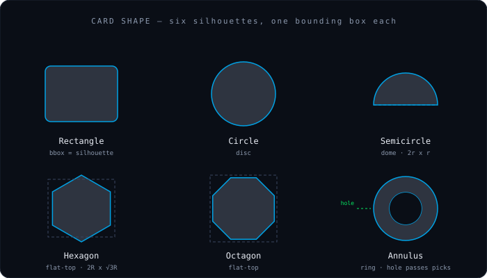
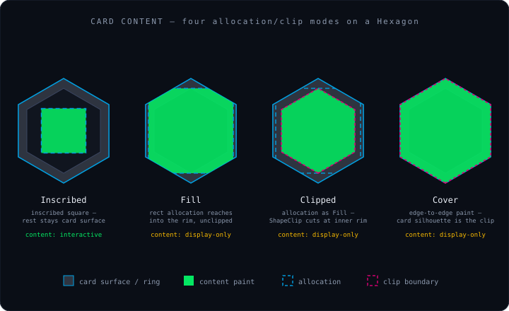
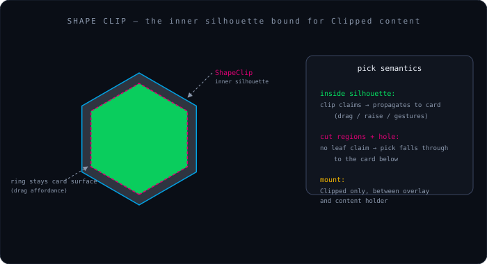

# Shapes

A card does not have to be a rectangle. `CardConfig::shape` picks one of
six silhouettes and the card clips everything to it — face, content,
chrome and shadow. Outside the silhouette the card is transparent *and*
click-through: picks in the cut corners (and inside an `Annulus`' hole)
fall through to the cards below as if the card were not there.

<figure class="diagram">
  
  <figcaption>the six `CardShape` silhouettes — every card still measures a rectangular bounding box</figcaption>
</figure>

## `CardShape`

| Variant | Silhouette | Footprint |
|---|---|---|
| `Rectangle` (default) | rounded rect | the allocation itself |
| `Circle` | disc | `2r × 2r` |
| `Semicircle` | dome, flat edge down | `2r × r` |
| `Hexagon` | flat-top hexagon | `2R × √3R`, cut corners |
| `Octagon` | flat-top octagon | `2R × 2R`, cut corners |
| `Annulus` | ring with a center hole | `2r × 2r`, hole is see- and pick-through |

All geometry works unchanged: the board still allocates a rectangle per
card (the silhouette's bounding box), rotation and scale apply to the
whole shape, and footprints/`contains` are silhouette-accurate rather
than bbox-accurate.

`Annulus` is the one shape with an extra parameter: `hole_ratio`
(default `0.5`, clamped to `0.05 – 0.95`) is the inner radius as a
fraction of the outer radius — `0.4` gives a broad band, `0.8` a thin
rim. The hole shows whatever is below the card and delivers picks
straight to it.

## `CardContent` — how content fills a shape

A rectangular consumer widget inside a non-rectangular card needs an
allocation contract. `CardConfig::content` selects one of four:

<figure class="diagram">
  
  <figcaption>`CardContent` on a `Hexagon` — allocation rect vs. clip boundary per mode</figcaption>
</figure>

| Mode | Allocation | Clip | Content is |
|---|---|---|---|
| `Inscribed` (default) | largest shape-inscribed rectangle | none — never reaches the rim | **interactive** |
| `Fill` | rectangle reaching into the rim | none — paints over the ring corners | display-only |
| `Clipped` | same allocation as `Fill` | `ShapeClip` at the *inner* silhouette | display-only |
| `Cover` | the full silhouette bbox | the card silhouette itself — edge-to-edge | display-only |

`Inscribed` keeps the content rectangle away from the silhouette, so the
rim around it stays card surface (the drag affordance) and child widgets
work unchanged. `Fill` lets the paint bleed into the rim — the corners
show through as card-colored only where the silhouette ends. `Clipped`
adds the `ShapeClip` boundary so the rim always reads as a clean ring.
`Cover` is for faces that *are* the shape — dials, gears, pie menus —
painting to the silhouette edge.

**Why immersive content is display-only.** GTK4 has no non-rectangular
pick masks: a rectangular content allocation covering the cut corners
would leaf-claim picks outside the silhouette and block the fall-through
that makes shapes stackable. On non-rectangular cards the content holder
in `Fill`, `Clipped` and `Cover` is therefore `can_target(false)` —
picks inside the silhouette still reach the card's own gestures via the
silhouette containers, and picks in the corners or the hole pass through.
(Rectangle cards keep interactive content in every mode.)

Content clicks still work when needed — attach a `GestureClick` *to the
card* and map the point with `widget.compute_point(&content_widget, …)`;
the click is only delivered when the silhouette claimed it. The
protractor in `examples/semicircle.rs` and the wedges in
`examples/pie_menu.rs` both react this way.

## `ShapeClip`

`ShapeClip` is the clip widget `Clipped` mounts between the content
overlay and the content holder. It owns two bounds:

- an **inner silhouette** — the outer silhouette shrunk by the chrome
  rim — which is the paint and pick boundary for its child;
- the **annulus band** between inner and outer silhouette (and, on
  `Annulus`, between the band and the hole), which stays claimable card
  surface.

<figure class="diagram">
  
  <figcaption>`ShapeClip` cuts `Clipped` content at the inner silhouette — the ring stays drag surface, cut regions pass picks through</figcaption>
</figure>

Inside the silhouette the clip claims the pick and it propagates to the
card (drag, raise, gesture controllers). Outside — the corners, and the
hole on `Annulus` — no leaf claims it and the pick falls through to
whatever is below.

## Chrome on shaped cards

Shaped cards have no header strip — chrome elements ride on *bands*
instead (`examples/arc_chrome.rs` shows all variants):

| Shape | Top band | Bottom band (`Bar*` placements) |
|---|---|---|
| `Circle` | arc, `arc_span` wide | arc, `arc_bottom_span` wide |
| `Annulus` | arc on the band's mid-radius | arc on the band's mid-radius |
| `Semicircle` | arc along the dome | straight bar on the flat edge |
| `Hexagon` / `Octagon` | straight bar on the top edge | straight bar on the bottom edge |

`arc_span` and `arc_bottom_span` (default a quarter turn each) widen or
narrow the arc bands. `ChromePlacement::Inline*`, `ArcTop*` placements
mount on the top band; `Bar`, `BarStart`, `BarEnd` mount on the bottom
band — which is *mirrored*: `BarStart` sits on the screen's right so a
user facing the card's bottom edge reads the strip left-to-right.
`Satellite` placements [orbit the card](satellites.md) independent of shape.

A completely chrome-free shaped card is `chrome: Some(vec![])` — bare
`chrome: None` falls back to the legacy default slots (title plus the
fold/close buttons the flags imply). With no chrome at all, wire
`drag_handle: WholeCard` and prefer `unfold_on_click` or satellite
buttons for the fold/close paths; on curved shapes a folded card hides
its bands, so a `Minimize` *satellite* stays visible as the unfold
affordance.

Try them: `cargo run --example annulus` (four `CardContent` modes × bar
variants on rings), `cargo run --example pie_menu` (an `Annulus` pie
menu with hover, click-through hole and rotation satellites),
`cargo run --example arc_chrome` (arc bands and `Cover` on `Circle`),
`cargo run --example semicircle` (dome cards including a `Cover`
protractor).
