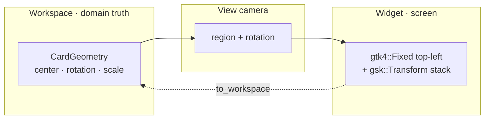

# Geometry

`floating-board` separates *where a card is* from *where it appears*.
Card state — `CardGeometry { position, rotation, scale }` — lives in
**workspace coordinates** on a virtual surface. A `View` camera maps a
region of that workspace onto the widget; GTK transform widgets then
map the widget onto the screen. Each hop is a different coordinate
space, and the crate keeps them strictly apart.

Three invariants hold the model together:

1. **The center is the anchor.** `CardPosition` stores the card's
   *center*, so rotation and scale never shift the point a user is
   pointing at.
2. **Geometry is written once.** The board owns every card's
   `CardGeometry`; `Card` objects are pure views.
3. **Transforms are render-time.** Scale and rotation apply via
   `gsk::Transform` at allocation — GTK's own picking inverts them,
   so card controls stay interactive at any angle.

## What's inside

- **[Coordinate Spaces](geometry/coordinates.md)**: workspace vs.
  widget vs. card-local — where `CardPosition` lives, how `View`
  maps between spaces, and why the center anchor matters.
- **[Transform Stack](geometry/transforms.md)**: the
  `ScalingWidget → RotationWidget → Card` nesting, how displayed
  size is predicted rather than read back, and animated transitions.
- **[Bounds & Clamping](geometry/clamping.md)**: `min_visible`,
  `BoundsMode::Loose` vs `Contained`, rotated footprints and the
  pure `clamp_offset` function.
