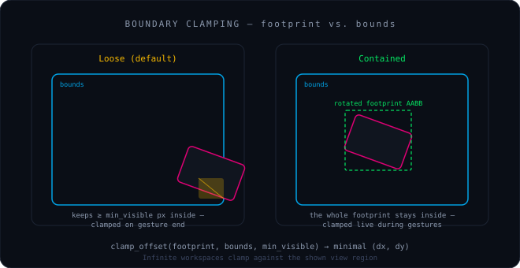

# Bounds & Clamping

A card may never get lost. `BoundsMode` decides how strictly the
card's **rotated footprint** stays inside the clamp domain — live
during gestures or only when they end.

<figure class="diagram">
  
  <figcaption>Loose keeps a min_visible slice; Contained keeps the whole footprint</figcaption>
</figure>

| `BoundsMode` | Rule | When |
|---|---|---|
| `Loose` (default) | at least `min_visible` px of the footprint must overlap the bounds on each axis | on drag end, rotation/scale change, resize, restore |
| `Contained` | the full footprint must stay inside at all times | clamped *live* during drag, pinch and rotation |

`min_visible` defaults to 40 px — a slice a user can still grab. The
required overlap is capped at half the bounds size, so clamping stays
satisfiable on tiny boards.

## The math

Clamping is a pure domain function — no GTK, directly unit-testable:

```rust,ignore
domain::clamp_offset(footprint: &Rect, bounds: &Rect, min_visible: MinVisible) -> (f64, f64)
```

It returns the minimal translation that puts `min_visible` pixels of
the axis-aligned footprint back inside `bounds` on each axis. Because
it operates on the footprint — the AABB of the rotated, scaled card —
the guarantee holds at any angle, not just quarter turns.

## The clamp domain

What "inside" means depends on the workspace:

- `WorkspaceSize::FollowWidget` / `Fixed` — the workspace extent.
- `WorkspaceSize::Infinite` — no extent exists; clamping falls back
  to the **shown view region**, so cards cannot be dragged off-screen
  and lost.
- `SeatAnchor::View` — the clamp domain widens to the shown region,
  so cards may rest at seat positions beyond the workspace extent.

`Infinite` never *re*-clamps on view changes — panning the camera
cannot drag cards along.

## Footprints and the safe area

`card.footprint()` returns a `gtk4::cairo::Region` — the union of
`rotated_region_scanlines` strips rasterized from the card's rotated
rect, the same algorithm `smearor-wrot-rotation` uses for its input
region. `board.cards_region()` unions all footprints into the board's
dynamic safe area; `board.card_footprint(&id)` resolves a single card.
Useful when the content layer should avoid drawing under cards — or
when it deliberately should.
