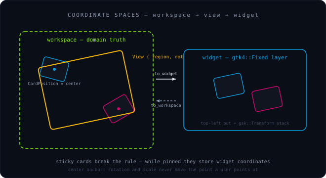

# Coordinate Spaces

Three coordinate spaces are in play, and the crate keeps them strictly
apart — a value from one is never silently used as another.

<figure class="diagram">
  
  <figcaption>workspace truth → view region → widget rendering</figcaption>
</figure>

| Space | Unit | Owner |
|---|---|---|
| **workspace** | `Vec2<Pixels>` on the virtual surface | domain — `CardGeometry` is stored here |
| **widget** | pixels on the `FloatingBoard` allocation | view — `View::to_widget` maps workspace → widget |
| **card-local** | pixels inside a card's transform stack | GTK — gesture source coordinates |

## The center anchor

`CardPosition` is the card's **center**, never its top-left. Rotation
and scale apply around the center, so the point a user looks at —
or drags — stays put while the card's bounding box changes shape.
`gtk4::Fixed` positions children by top-left, so the board converts on
every placement:

$$\text{top-left} = \text{center} - \frac{\text{displayed size}}{2}$$

The *displayed size* is predicted, not read back: `RotatedLayout`'s
measure reports the rotated bounding box of the natural size, and
`ScalingLayout` multiplies by the scale — so
`rotated_bounds(w·s, h·s, θ)` always equals what `GtkFixed` allocates
next. The center anchor stays exact even while a rotation or scale
transition is still pending re-allocation.

## The view mapping

`board.view()` returns the effective `View<Pixels>` — `{ region,
rotation }`. It converts both ways:

```rust,ignore
let view = board.view();
let on_screen = view.to_widget(workspace_point);
let on_table  = view.to_workspace(widget_point);
```

`view.shown_region(allocation)` reports the region actually on screen:
the mapped workspace region aspect-expanded to the widget's aspect
ratio — the honest answer to "what does the user see".

Sticky cards are the deliberate exception: while `sticky`, a card's
stored position is in **widget** coordinates (also what
`Card::geometry()` and layout snapshots report); all other cards
always speak workspace. See [Sticky Cards](../workspace/sticky.md).

## Diagnostics

`board.card_alignment(&card)` returns a `CardAlignment` — model
position, stored `put` spot on the layer and rendered bounds in
widget coordinates. The invariant is
`rendered.center() == position` (rotation and scale apply around the
center); `drift` quantifies any violation. It exists for
input-region coverage checks and geometry debugging, not for daily
use.
