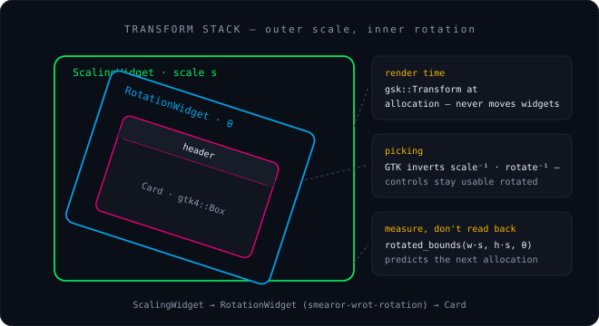

# Transform Stack

Each card renders through a nested transform stack on the
`gtk4::Fixed` layer:

<figure class="diagram">
  
  <figcaption>outer scale, inner rotation — controls stay usable at any angle</figcaption>
</figure>

- **`ScalingWidget`** — outer transform, applies the card's
  `ScaleFactor` around the center via `ScalingLayout`.
- **`RotationWidget`** (`smearor-wrot-rotation`) — inner transform,
  applies `SmearorRotation` around the center via `RotatedLayout`.
- **`Card`** — the `gtk4::Box` with header and content.

Both transforms are applied as `gsk::Transform` at allocation time —
not by moving widgets. That is the trick that keeps cards usable:
GTK4's picking machinery automatically multiplies the pointer by the
full inverse stack `scale⁻¹ · rotate⁻¹`, so a rotated, zoomed card's
buttons land exactly where the user sees them. The same stack gives
`card.footprint()` its region — the rasterized union of scanline
strips.

## Predicted sizes

The layouts' `measure` is what makes the center anchor work without a
read-back: `RotatedLayout` reports the rotated bounding box of the
card's natural size, `ScalingLayout` multiplies it by the scale
factor. The board can therefore compute where the card *will* be
allocated and keep `CardPosition` consistent mid-transition.

## Animated transitions

Geometry writes can animate on the frame clock instead of snapping:

| Call | Effect |
|---|---|
| `card.set_rotation_with_animation(rotation)` | zoom-snap transition to the new angle |
| `card.glide_to(&geometry)` / `board.glide_card_geometry(&id, target)` | slide position, rotation and scale together |
| `apply_layout(..., animated: true)` | every placement glides instead of jumping |
| `goto_card(&id, transition, rotation)` | camera flight — see [goto_card](../workspace/goto.md) |

Duration comes from the card's `animation_speed_ms` (default 500 ms).
Animations are superseded, not queued: a new animated write to the
same card bumps a `SequenceNumber` generation and ticks of the old
animation notice the stale generation and stop themselves — so a
`goto_card` during a glide, or a gesture during a `goto_card`, simply
wins.

Rotation changes (gesture snap *or* programmatic) also re-center the
card on its anchor and re-clamp it into the bounds — the board
connects `notify::rotation` on the `RotatedLayout` once per card —
and emit `card-rotated` plus `geometry-changed`.
