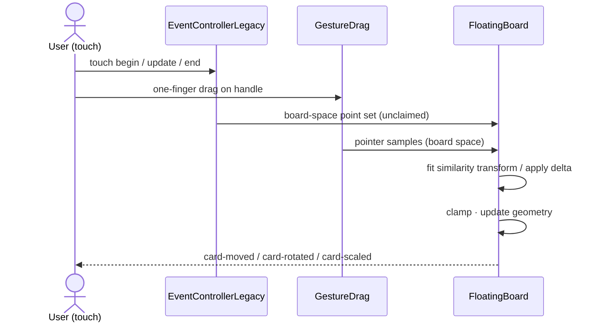

# Gestures

Cards are manipulated by several users at once, from any side of the
table — so the gesture layer is designed for independence: every card
carries its own controllers, every touch sequence is tracked
separately, and nothing grabs input globally.

| Gesture | Controller | Effect |
|---|---|---|
| 1-finger drag on handle/header/card | `GestureDrag` | move (live), clamp on end |
| 1-finger tap on card | `GestureClick` | raise on release |
| 2+ fingers on card | `EventControllerLegacy` (quad tracker) | move + rotate + scale in one similarity fit |
| Rotate grip swipe | `GestureDrag` | quarter-turn in the swipe direction |
| Resize grip drag | `GestureDrag` | scale around the card center |
| Drag on empty space | `GestureDrag` (opt-in) | pan the view camera |
| Pinch / twist on empty space | quad tracker (opt-in) | zoom / rotate the view camera |

Card gestures claim sequences before view gestures, and touches
starting on a card are denied to the camera outright — cards always
win.

## What's inside

- **[Drag & Raise](gestures/drag.md)**: the one-finger path — how the
  board derives deltas in board space without a feedback loop, drag
  handles, grips, raise-on-release.
- **[Quad Transform](gestures/quad.md)**: the multi-touch path — the
  unclaimed point-cloud tracker, the centroid/radius/Procrustes fit,
  re-baselining and stale-touch sweeping.
