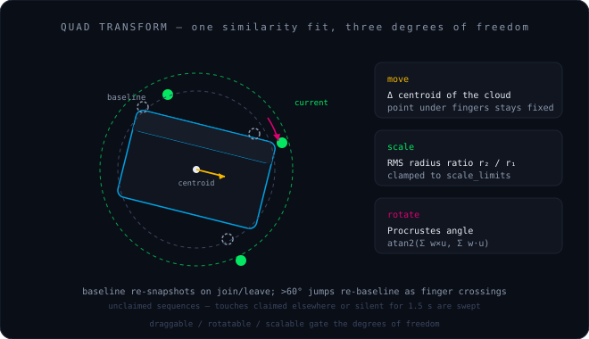

# Quad Transform

Move, rotate and zoom are **one** gesture, not three competing ones.
A raw `EventControllerLegacy` on each card observes every touch
sequence — `TouchBegin`, `Update`, `End`, `Cancel` — **without
claiming any**. Each live finger maps to a tracked board-space point;
with two or more points the board fits a similarity transform between
a baseline point cloud and the current one. (`GestureSingle`-based
slots were abandoned: a single locks onto the first sequence it sees
and cannot distribute touches across siblings — and unclaimed
sequences keep buttons and content on the card working.)

<figure class="diagram">
  
  <figcaption>one similarity fit: centroid = move, radius ratio = scale, Procrustes angle = rotate</figcaption>
</figure>

## The fit

The tracker keeps `TrackedTouch` points in card-layer board space.
Against the baseline cloud, the current cloud yields all three
degrees of freedom at once:

- **Move** — the card center follows the point-cloud centroid: the
  card point under the finger polygon stays fixed.
- **Scale** — the RMS radius ratio of the two clouds, clamped to
  `scale_limits`; the card keeps its aspect ratio.
- **Rotate** — the Procrustes angle
  `atan2(Σ w×u, Σ w·u)` between the two point sets, applied via
  `RotationWidget::set_rotation` (negated — the angle is computed in
  y-down screen coordinates).

`draggable` / `rotatable` / `scalable` gate which degrees of freedom
apply to the fit — a card with `rotatable: false` moves and scales
without turning.

## Re-baselining

The baseline re-snapshots whenever a finger joins or leaves, so the
transform never jumps mid-gesture. Two safety valves handle the
degenerate cases:

- **Finger crossing** — a frame-to-frame angle jump beyond 60°
  usually means the point cloud passed through its own centroid;
  the tracker re-baselines instead of applying a violent twist.
- **Lost touches** — a touch that gets claimed by another gesture,
  or produces no event for `QUAD_STALE_MS` (1.5 s), is swept out on
  the next update. Slot ids recycle, so a stale slot can belong to a
  *new* touch — the timestamp check is what tells them apart, and
  lost `TouchEnd` events cannot linger as phantom points.

`smearor-wrot-rotation`'s built-in rotate gesture is disabled on the
board — the quad fit already covers rotation and keeps all three
DOFs consistent.
