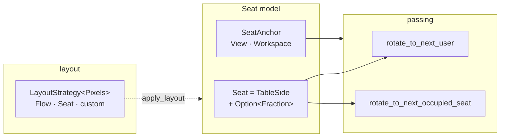

# Tabletop

`floating-board` is built for table-top surfaces: several users stand
around one horizontal screen, each reading from their own side. The
**tabletop** vocabulary models *who* a card belongs to — independently
of *which way the card is currently turned* — and moves cards between
users in reading orientation.

`smearor-commons-layout` provides the generic machinery —
`TableSide`, `Seat`, `LayoutStrategy`, `FlowLayout`, `SeatLayout` —
and the board adapts card state to and from it. The layout crate's
[book](https://smearor.github.io/smearor-commons/book/layout.html)
documents the primitives; the chapters here document what the board
does with them.

## What's inside

- **[Seats](tabletop/seats.md)**: `Seat`, pinned vs. distributed
  positions, `SeatAnchor` — whether seats live at the screen edge or
  on the virtual table.
- **[Passing Cards](tabletop/passing.md)**: `rotate_to_next_user`,
  the occupied-seat roster, fan-out lanes and the `NoNextSeat` error.
- **[Layout Strategies](tabletop/layouts.md)**: `apply_layout` —
  mapping cards to `LayoutItem`s, animated placement, `DoesNotFit`
  and writing custom strategies.
