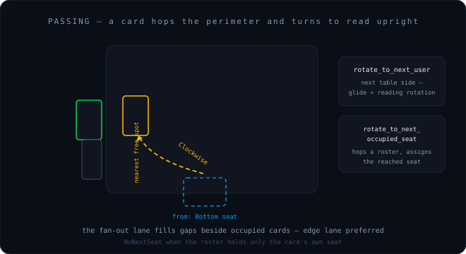

# Passing Cards

Passing is the tabletop signature move: a card glides to another
user's edge and turns into *their* reading orientation. Two entry
points cover the two questions — "next side of the table" and "next
person actually playing".

<figure class="diagram">
  
  <figcaption>passing hops the perimeter and lands in the fan-out lane, rotated to read upright</figcaption>
</figure>

## Next side of the table

```rust,ignore
// Bottom → Left → Top → Right (CounterClockwise reverses),
// gliding to the edge at anchor_margin and rotating into the
// side's reading orientation:
board.rotate_to_next_user(&id, TurnDirection::Clockwise, true)?;
```

`move_to_edge` (usually `true`) slides the card in front of the
target edge; `false` rotates it in place. `rotate_to_next_user` only
advances an **explicitly assigned** seat — unassigned cards derive
their starting side from their current rotation each time, which
still gives a sensible "turn it toward the next side".

## Next occupied seat

```rust,ignore
let roster = [Seat::new(TableSide::Bottom), Seat::center(TableSide::Top)];
board.rotate_to_next_occupied_seat(&id, &roster, TurnDirection::Clockwise, true)?;
```

The roster is the occupied seats — empty sides are skipped, several
seats on one side are visited in order. The reached roster seat is
**assigned** to the card (`card-seat-changed`): being passed to a
user makes the card belong to their seat, which is what lets repeated
passes keep hopping the roster. `BoardError::NoNextSeat` comes back
when the roster holds no seat other than the card's current one.

## The fan-out lane

A passed card does not stack on top of what is already there — it
slips into the free spot nearest its seat:

- it fills gaps left by removed cards along the edge,
- it sits beside occupied cards without overlap,
- and it may take the lane *behind* the edge row when the queue there
  would reach farther from the seat than a second row — the edge lane
  is preferred, but closeness to the seat wins.

Sticky cards are released to the table before the pass lands; other
sticky cards count as obstacles only under `SeatAnchor::View` — see
[Seats](seats.md#where-the-edges-live).
