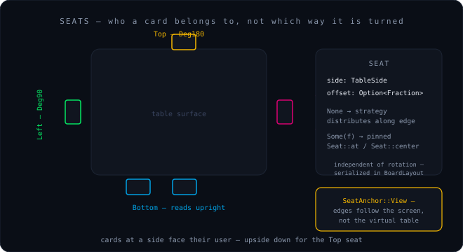

# Seats

A `Seat` (from `smearor-commons-layout`) is a `TableSide` plus an
optional `Fraction` offset along the edge. It models *which user a
card belongs to* — deliberately decoupled from the card's rotation,
because the board may be rotated and users may move around.

<figure class="diagram">
  
  <figcaption>seats live on the perimeter clock — cards rotate to face their side</figcaption>
</figure>

```rust,ignore
use smearor_commons_layout::{Seat, TableSide};
use smearor_commons_geometry::Fraction;

let config = CardConfig {
    seat: Some(Seat::new(TableSide::Bottom)),                      // assigned, strategy distributes
    // seat: Some(Seat::at(TableSide::Top, Fraction::new(0.25))),  // pinned to a position
    // seat: Some(Seat::center(TableSide::Left)),                  // centered on an edge
    ..Default::default()
};

let seat = card.seat();
card.set_seat(Some(Seat::center(TableSide::Right)));  // emits card-seat-changed
board.set_card_seat(&id, None)?;                      // clear via the board
```

- **Pinned** — `Seat::at(side, fraction)` takes an exact offset along
  the edge.
- **Distributed** — `offset: None` lets a strategy (or the pass
  fan-out) pick a spot.
- **`Seat::nearest`** derives the closest seat from a rotation — used
  for unassigned cards; under `SeatAnchor::View` it reads the
  *rendered* (card + view) rotation, under `Workspace` the workspace
  rotation.

Seats serialize into `BoardLayout` via `CardPlacement::seat`.

## Where the edges live

`board.set_seat_anchor` chooses what "the table edge" means for
pass-to-seat operations:

| `SeatAnchor` | Edges | Effect |
|---|---|---|
| `View` (default) | the **screen** edge — where the users physically sit | a passed card lands at the visible edge facing its user, however the camera is panned, zoomed or rotated; the clamp domain widens to the shown region |
| `Workspace` | the **workspace extent** — fixed positions on the virtual table | the card lands at the workspace edge wherever the view currently shows it |

The whole pass placement — edge position, fan-out lane, margin,
target rotation — is computed in the anchor's space and mapped back
through `to_workspace`, so `SeatAnchor::View` is the mode that keeps
"the bottom seat" glued to "the user standing at the bottom of the
screen" even while the table is turned.
