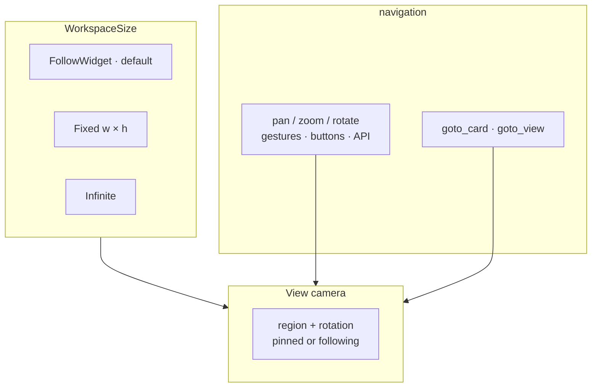

# Workspace & View

Card geometry lives on a **virtual workspace** — a surface that can be
exactly the widget, a fixed table larger than the screen, or unbounded.
A **`View`** camera decides which part of the workspace the widget
shows, so panning, zooming and rotating the table never touches card
state. Sticky cards opt out: they pin to the glass instead of the
table.

## What's inside

- **[Workspace Size](workspace/size.md)**: `FollowWidget`, `Fixed` and
  `Infinite` extents — and how each mode decides the clamp domain.
- **[The Camera](workspace/camera.md)**: the `View` value, pinning and
  resetting, `pan_view`/`zoom_view`/`rotate_view`, opt-in view
  gestures and the overlay control buttons.
- **[goto_card](workspace/goto.md)**: camera flights onto a card —
  `Snap`, `Glide` and the Prezi-style `Transit`, plus `GotoRotation`
  and the flight lifecycle.
- **[Sticky Cards](workspace/sticky.md)**: cards pinned to the screen —
  the coordinate seam, layout interactions and the release-to-table
  rules.
