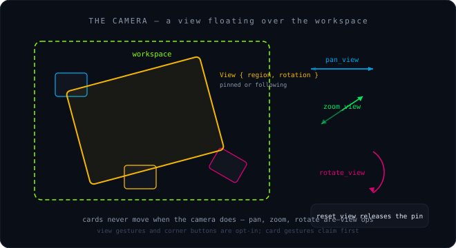

# The Camera

`View<Pixels>` is the camera: a workspace `region` plus a `rotation`
that decides what the widget shows. Cards never move when the camera
does — panning, zooming and rotating the table is a pure view
operation.

<figure class="diagram">
  
  <figcaption>the view region floats over the workspace — cards stay where they are</figcaption>
</figure>

## Pinning and resetting

```rust,ignore
let view = board.view();                  // the effective view, pinned or default
board.set_view(view);                     // pin an explicit view
board.reset_view();                       // release the pin
board.pan_view(Vec2::<Pixels>::new(100.0, 0.0));
board.zoom_view(anchor, ViewScaleFactor::new(1.25));   // zoom around a workspace point
board.rotate_view(pivot, RotationRad::from_degrees(90.0));
```

The default view covers the workspace extent and follows the widget —
resizes keep it covering the extent. `set_view` and every pan/zoom/
rotate **pin** an explicit view: resizes no longer change zoom or
center until `reset_view` releases the pin.

`View` itself offers `to_widget`/`to_workspace` for coordinate
mapping and `shown_region` for the aspect-expanded region actually on
screen — see [Coordinate Spaces](../geometry/coordinates.md).

## User control

Both controls are opt-in (default off) because they share the touch
surface with card gestures:

- `board.set_view_gestures(true)` — a drag on empty space pans, a
  pinch zooms around the gesture center, a two-finger twist rotates
  the table. Card gestures keep precedence: they claim sequences
  first, and touches starting on a card are denied up front.
- `board.set_view_buttons(true)` — overlaid corner controls (zoom in,
  zoom out, reset) styled via `.floating-board-view-controls`.

## Custom flights

`board.goto_view(target, transition, duration)` flies the camera to
an arbitrary `View` — the same machinery `goto_card` uses, exposed
for camera choreography that is not about a card.
