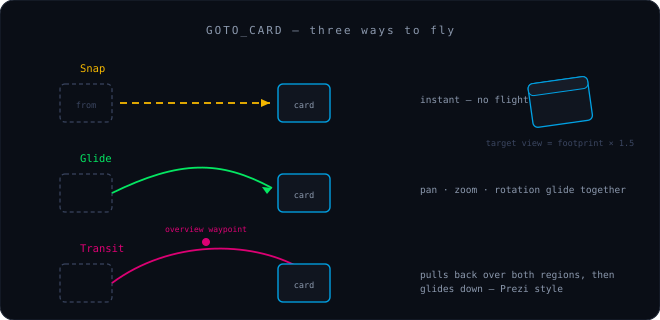

# goto_card

`goto_card` is the camera's answer to "show me that card": it flies
the view onto the card's workspace footprint — and optionally turns
the table so the card reads upright for the viewer.

<figure class="diagram">
  
  <figcaption>Snap jumps, Glide flies direct, Transit pulls back first — Prezi style</figcaption>
</figure>

```rust,ignore
use floating_board::{GotoRotation, GotoTransition};

board.goto_card(&id, GotoTransition::Glide,   GotoRotation::Upright)?;
board.goto_card(&id, GotoTransition::Transit, GotoRotation::Upright)?;
board.goto_card(&id, GotoTransition::Snap,    GotoRotation::Keep)?;
```

## Transitions

| `GotoTransition` | Flight |
|---|---|
| `Snap` | apply the target view instantly |
| `Glide` (default) | pan, zoom and rotation glide together on the frame clock |
| `Transit` | Prezi-style: pull back to a region covering *both* the current and the target view, then glide down onto the card — one flight over a waypoint, not two chained animations |

## Rotations

| `GotoRotation` | Destination |
|---|---|
| `Keep` | pan/zoom only — the table keeps its rotation |
| `Upright` | rotate the view so the card reads upright for the viewer |

The target view centers the card's workspace footprint with a padding
margin (`GOTO_CARD_PADDING` = 1.5× the footprint). Flights run on the
card's `animation_speed_ms`.

## Lifecycle

A new `goto_card` **supersedes** a running one — the animation
generation bumps and the old flight's ticks stop themselves. Any
programmatic or gesture view change cancels a flight in progress.
The destination **pins** the view like `set_view` — `reset_view`
releases it.

A `sticky` target is pinned to the glass itself: the camera moves to
the workspace region *behind* it, and `rotation` is ignored — turning
the table cannot turn a card that is not on it.
