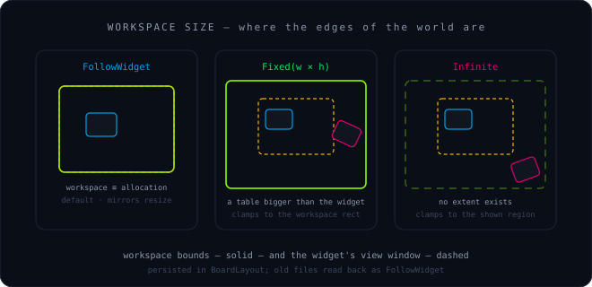

# Workspace Size

`WorkspaceSize<Pixels>` (from `smearor-commons-layout`) is the extent
of the virtual surface card geometry lives on. Card positions are
always workspace coordinates — the mode only decides where the edges
of the world are.

<figure class="diagram">
  
  <figcaption>three extents: mirror the widget, a fixed table, or no border at all</figcaption>
</figure>

```rust,ignore
use smearor_commons_layout::WorkspaceSize;
use smearor_commons_geometry::{Pixels, Vec2};

board.set_workspace_size(WorkspaceSize::FollowWidget);               // default
board.set_workspace_size(WorkspaceSize::Fixed(Vec2::<Pixels>::new(2000.0, 1600.0)));
board.set_workspace_size(WorkspaceSize::Infinite);
```

| Mode | Extent | Clamp domain |
|---|---|---|
| `FollowWidget` (default) | mirrors the widget allocation — identical to pre-workspace behavior | the allocation |
| `Fixed(size)` | a fixed workspace in pixels, origin at (0, 0) — a table bigger than the widget | the workspace rect |
| `Infinite` | unbounded — no extent exists | the *shown view region*, so cards cannot be lost off-screen |

`board.workspace_bounds()` returns the active `Rect<Pixels>` — the
resolved extent for `FollowWidget`/`Fixed`, or the shown region for
`Infinite`.

The choice is persisted: `workspace` is a field of `BoardLayout`
(`serde(default)` — files written before the workspace read back as
`FollowWidget`, exactly the old behavior).
